<a href="https://hyowonbernabe.me"></a><a href="https://github.com/hyowonbernabe?tab=repositories"></a><a href="https://github.com/hyowonbernabe/Messenger-Z"></a><a href="https://globit-transient.vercel.app/"></a><a href="https://github.com/hyowonbernabe/tos-risk-summarizer"></a><a href="https://www.linkedin.com/feed/update/urn:li:activity:7378736743283367936/"></a><a href="https://github.com/hyowonbernabe/ShadowPrompt"></a><a href="https://github.com/hyowonbernabe/Kuroko"></a><a href="https://i-tril.vercel.app/"></a><a href="https://hyowonbernabe.me"></a><a href="mailto:contact@hyowonbernabe.me"></a>
